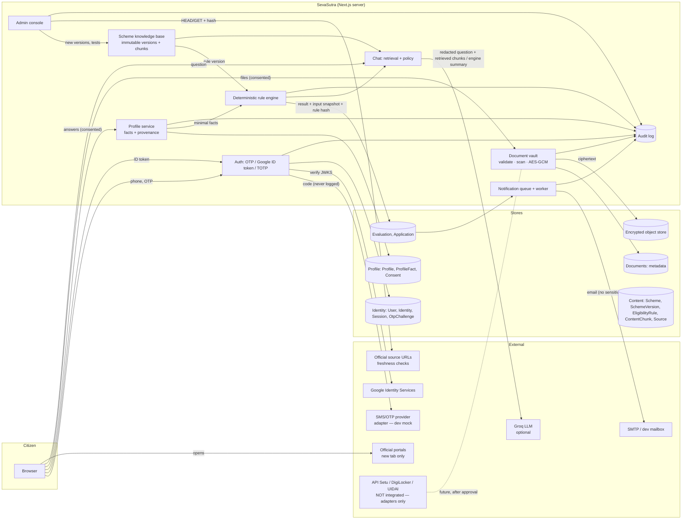

# Data-flow diagram

## What crosses each boundary
| Flow | Data | Protection |
|---|---|---|
| Browser → OTP provider | Phone number, 6-digit code | Code hashed (HMAC) at rest, 5-min TTL, 5 attempts, lockout, never logged |
| Browser → Google | Google ID token | Verified server-side against Google JWKS; grants explorer only |
| Profile → engine | Only facts the rule references | Evaluation stores a *minimal* snapshot, not the whole profile |
| Vault → disk | File bytes | Magic-byte type check, 5 MB cap, malware scan, AES-256-GCM, random object key, no public URL; 5-min signed link + session owner check |
| Chat → LLM | Redacted question, retrieved chunks, engine summary | No profile values, no documents, no identifiers; source text wrapped as data; output citation-validated |
| Queue → email | Template + authenticated link | Subject lines are generic; links require sign-in; one-click unsubscribe |
| Admin → source sites | URL fetch | Low rate, identified user agent, hash only (no scraping) |
